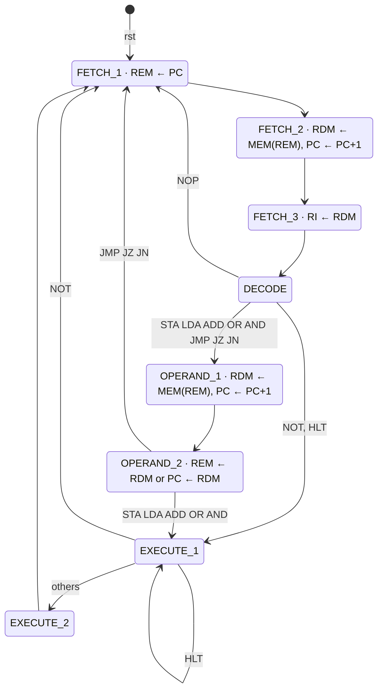

# Neander — Control Unit & FSM

Control unit of the **Neander** 8-bit educational CPU, written in Verilog. It is the part I designed in the team project [Neander CPU in Verilog](https://github.com/Anakarolynas/Neander-verilog), kept here as a standalone module with its own testbenches.

The control unit has two blocks:

- **`fsm.v`**: a sequencer that tracks which step of the fetch / decode / execute cycle the CPU is in. The number of steps depends on the instruction.
- **`unit_control.v`**: instantiates the FSM and decodes *(state, opcode, Z, N)* combinationally into the datapath control signals.

State encodings live in a single shared header (`neander_states.vh`), so the FSM and the decoder cannot drift apart.

## State machine



Design notes:

- **Jumps finish in `OPERAND_2`.** The PC is loaded from RDM there, so `JMP`/`JZ`/`JN` skip the execute states. A conditional jump that is not taken still reads its operand, so the PC moves past it.
- **`HLT` parks the FSM** in `EXECUTE_1` until reset.
- **The decoder gives every output a default value** before the `case` (all loads off), so each state only drives the signals it needs and no latches are inferred.

## Interface

| Signal | Dir | Description |
|---|---|---|
| `clk`, `rst` | in | Clock and asynchronous reset |
| `opcode[3:0]` | in | `RI[7:4]` |
| `Z`, `N` | in | Zero and negative flags |
| `carga_rem`, `sel_rem` | out | Load REM; source 0 = PC, 1 = RDM |
| `carga_rdm`, `sel_rdm` | out | Load RDM; source 0 = memory, 1 = AC |
| `read`, `write` | out | Memory read / write |
| `carga_ri` | out | Load instruction register |
| `incrementa_pc`, `carga_pc`, `goto0` | out | PC increment / load from RDM / reset to 0 |
| `sel_ula[2:0]` | out | ALU operation |
| `carga_ac`, `carga_nz` | out | Load accumulator / N-Z flags |

## Running the testbenches

Requires [Icarus Verilog](https://steveicarus.github.io/iverilog/). GTKWave is optional, for waveforms.

```bash
./tb/fsm/fsm_tb.sh                     # Linux / macOS
./tb/unit_control/unit_control_tb.sh
```

```bat
tb\fsm\fsm_tb.bat                      :: Windows
tb\unit_control\unit_control_tb.bat
```

Both testbenches are self-checking: they walk every instruction through its states, compare the control signals against the expected values and print `RESULTADO: todos os testes passaram` at the end. Waveforms are written to `sim/`.

## History

The first version of this repo had the state encodings duplicated in both files. They diverged, and two states ended up sharing the same code. Moving the encodings into one header fixed the bug and made it impossible to repeat. The final version, including a third fetch step so the opcode is valid before decoding, is what is here now.
